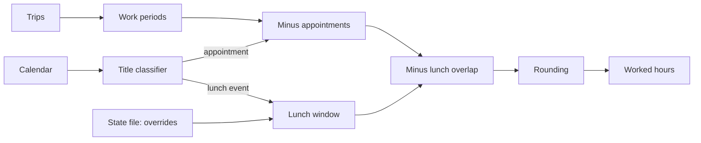

# fnt-18-lunch-break-with-per-day-override Lunch break with per-day override

## Conversation Evidence

> user (turn 16): "also for the tracking i might need to specfy when i take lunch. Since on days visiting a client or doctors visits i might need to specify when i take lunch break. but on normal days its just 0.5h stating at 12."

## Goal & Context

Worked hours must leave out the lunch break. On a normal day lunch is 30 minutes from 12:00. On a customer day or a day with a doctor's visit, lunch may be at another time, and the user needs to say when, both from the CLI and later from the app (FNT-21).
<!-- Source: 70% user / 20% [paraphrase] / 10% [inferred] -->

## Architecture & Data Models

- A day's lunch window is resolved in this order: a per-day override, a lunch calendar event, the default window.
- The lunch deduction is the overlap of the lunch window with the work time left after private appointments (FNT-17), then rounding applies. It replaces the flat unpaid-break minutes.
- Per-day overrides live in a local state file next to the config: one JSON document, written atomically, extensible by later specs (FNT-19 stores its upload receipts there). [inferred]



## API Contracts

- Config `[lunch]`: `start` (default `12:00`), `minutes` (default `30`), `title` (default `Frokost`). The old `periods.unpaid_break_minutes` key is rejected with a message naming `[lunch]`. [inferred]
- CLI: `lunch set <YYYY-MM-DD> <HH:MM> <minutes>` and `lunch clear <YYYY-MM-DD>` store or remove a day's override. [inferred]
- Report and working-time record show each day's lunch window and its source: `default`, `calendar`, `override`.

## Edge Cases & Constraints

- A day with no time at work, or work only outside the lunch window, gets no deduction.
- A lunch window partly inside work time deducts only the overlap; lunch inside a doctor's visit is not deducted twice.
- An override of 0 minutes means no lunch that day.

## Acceptance Criteria

- **R1:** On a normal day the overlap of 12:00–12:30 with the remaining work time is deducted. Errors: no work in that window → no deduction; lunch overlapping a private appointment is not deducted twice. [paraphrase]
- **R2:** The user can set a day's lunch start and length from the CLI; that day uses it instead of the default, and it survives restarts. Errors: an invalid date or time is rejected naming it; an override of 0 minutes means no lunch; a corrupt state file stops with its path named and is never overwritten silently. [paraphrase]
- **R3:** A timed calendar event with the lunch title sets that day's lunch window unless an override exists; it is not a work address and adds no planned hours. No error surface beyond R2.
- **R4:** The report and the working-time record show each day's lunch window and its source. No error surface beyond R1. [inferred]
- **R5:** A config still using `periods.unpaid_break_minutes` fails to load with a message pointing to `[lunch]`. No error surface beyond that. [inferred]

## Early proof point

Task fnt-18-lunch-break-with-per-day-override.1 validates the state file (atomic write, round-trip, corrupt-file handling) that FNT-19 also builds on. If it fails, re-evaluate local persistence before continuing with .2.

## Boundaries

- One break per day. [inferred]
- No lunch rules by weekday or contract. [inferred]

## Decision Context

Overlap-based deduction makes errand days work without a special rule: a lunch errand already leaves a gap in the work periods, so nothing more is deducted. A separate "break seen in the trips" rule was dropped for that reason and because it could hide a doctor's visit. Overrides are stored locally, not in the calendar, because the Proton share link is read-only and the phone app must be able to set them.

## Quick commands

```bash
cargo test month:: state::
cargo run -- -c config.example.toml report 2026-10 -t examples/trips.csv
```

## Requirement coverage

| Req | Description | Task(s) | Gap justification |
| --- | --- | --- | --- |
| R1 | On a normal day the overlap of 12:00–12:30 with the remaining work time is deducted. Errors: no work in that window → no deduction; lunch overlapping a private appointment is not deducted twice. | fnt-18-lunch-break-with-per-day-override.2 | — |
| R2 | The user can set a day's lunch start and length from the CLI; that day uses it instead of the default, and it survives restarts. Errors: an invalid date or time is rejected naming it; an override of 0 minutes means no lunch; a corrupt state file stops with its path named and is never overwritten silently. | fnt-18-lunch-break-with-per-day-override.1 | — |
| R3 | A timed calendar event with the lunch title sets that day's lunch window unless an override exists; it is not a work address and adds no planned hours. No error surface beyond R2. | fnt-18-lunch-break-with-per-day-override.2 | — |
| R4 | The report and the working-time record show each day's lunch window and its source. No error surface beyond R1. | fnt-18-lunch-break-with-per-day-override.2 | — |
| R5 | A config still using `periods.unpaid_break_minutes` fails to load with a message pointing to `[lunch]`. No error surface beyond that. | fnt-18-lunch-break-with-per-day-override.2 | — |

