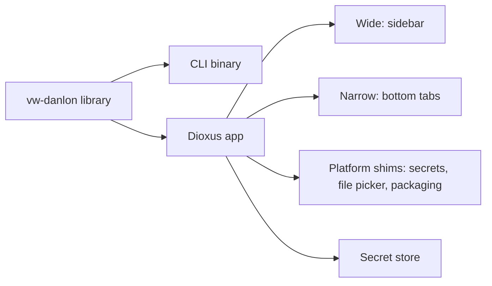

# fnt-21-dioxus-desktop-and-phone-app Dioxus app, responsive for desktop and Android

## Conversation Evidence

> user (turn 12): "also could you design a mockup for a ui app for this. the app is going to be desktop and phone with a light and dark mode written in rust using dioxus. and please use the design system of this previous mockup (https://claude.ai/artifact/UeddNBPX2SVMhcmm5AFWXV)"
> user (turn 20): "also please add a vaction function to the app"
> user (turn 22, selected): "Desktop + Android"

## Goal & Context

One graphical app over vw-danlon that runs on desktop and Android with a responsive layout, with light and dark mode, written in Rust using Dioxus. It follows the mockup at https://claude.ai/artifact/K5zwEk1uPeNuifnnaZjZ2W, which uses the design system of https://claude.ai/artifact/UeddNBPX2SVMhcmm5AFWXV.
<!-- Source: 55% user / 20% [paraphrase] / 25% [inferred] -->

## Architecture & Data Models

- The working-time, mileage, calendar, vacation, state and Danløn logic moves into a library crate used by both the CLI and the app; the CLI keeps its behaviour byte for byte.
- A Cargo workspace holds the library, the CLI and the Dioxus app. There is one app and one set of screens; the layout follows the window width, not the platform: wide shows the sidebar, narrow shows bottom tabs, as in the mockup's desktop and phone boards. Only packaging, the secret store and the file picker differ per platform.
- The Danløn send flow is split into a pure plan (FNT-19) and an executor, so the app confirms in a dialog where the CLI prompts on stdin.



## API Contracts

- Screens: Month, Day, Vacation, Mileage logbook, Send to Danløn, Settings, each showing the data the matching CLI command shows.
- Theme: light, dark and system, using the design system's colour tokens and IBM Plex Sans.

## Edge Cases & Constraints

- Secrets (calendar link, Danløn token): the OS keychain on desktop and Android Keystore-backed storage on Android; the CLI keeps reading its config file and environment. [inferred]
- Trips reach the app by importing a CSV or JSON trips file (desktop file picker, Android document picker). [inferred]
- Sending to Danløn always shows the plan and asks before sending.

## Acceptance Criteria

- **R1:** The app builds and runs on Linux desktop and Android from one Rust code base using Dioxus. Errors: missing config, calendar or trips → the app opens on Settings with the problem named. [paraphrase]
- **R2:** The app has light, dark and system themes. No error surface. [paraphrase]
- **R3:** The app has the Month, Day, Vacation, Mileage logbook, Send to Danløn and Settings screens, laid out as in the mockup. No error surface beyond R1. [paraphrase]
- **R4:** For the same config, calendar and trips, the app shows the same hours, mileage, vacation and pay lines as the CLI, and the CLI's output is unchanged by the library split. No error surface beyond R1. [inferred]
- **R5:** Sending to Danløn from the app shows the send plan (own and foreign waiting parts) and sends only after confirmation. Errors: Danløn unreachable or token refused → nothing is sent and the reason is shown. [inferred]
- **R6:** Secrets are kept in the platform's secret store. Errors: store unavailable → the app says so and does not fall back to a plain file. [inferred]
- **R7:** The user can import a trips file on desktop and Android. Errors: an unreadable or malformed file is rejected with the first bad line named. [inferred]
- **R8:** The layout follows the window width on every platform: wide shows the sidebar, narrow shows bottom tabs, with the same screens and features. No error surface. [paraphrase]

## Early proof point

Task fnt-21-dioxus-desktop-and-phone-app.1 validates the library split against the CLI's current output. If it fails, re-evaluate the crate layout before continuing with .2+.

## Boundaries

- No fetching trips from Volkswagen: VW's data sources give no trip addresses. [paraphrase]
- No iOS build. [paraphrase]
- No rules beyond FNT-17 to FNT-20; the app shows them.

## Decision Context

Splitting the logic into a library keeps the CLI and the app from drifting apart, and it lands after FNT-17 to FNT-20 so those are not moved twice. File import is the trips source until a phone trip source exists.

## Quick commands

```bash
cargo test --workspace
cargo run -p vw-danlon -- -c config.example.toml report 2026-10 -t examples/trips.csv
dx serve -p vw-danlon-app --platform desktop
```

## Requirement coverage

| Req | Description | Task(s) | Gap justification |
| --- | --- | --- | --- |
| R1 | The app builds and runs on Linux desktop and Android from one Rust code base using Dioxus. Errors: missing config, calendar or trips → the app opens on Settings with the problem named. | fnt-21-dioxus-desktop-and-phone-app.2 | — |
| R2 | The app has light, dark and system themes. No error surface. | fnt-21-dioxus-desktop-and-phone-app.2 | — |
| R3 | The app has the Month, Day, Vacation, Mileage logbook, Send to Danløn and Settings screens, laid out as in the mockup. No error surface beyond R1. | fnt-21-dioxus-desktop-and-phone-app.3, fnt-21-dioxus-desktop-and-phone-app.4, fnt-21-dioxus-desktop-and-phone-app.5 | — |
| R4 | For the same config, calendar and trips, the app shows the same hours, mileage, vacation and pay lines as the CLI, and the CLI's output is unchanged by the library split. No error surface beyond R1. | fnt-21-dioxus-desktop-and-phone-app.1, fnt-21-dioxus-desktop-and-phone-app.3, fnt-21-dioxus-desktop-and-phone-app.4 | — |
| R5 | Sending to Danløn from the app shows the send plan (own and foreign waiting parts) and sends only after confirmation. Errors: Danløn unreachable or token refused → nothing is sent and the reason is shown. | fnt-21-dioxus-desktop-and-phone-app.5 | — |
| R6 | Secrets are kept in the platform's secret store. Errors: store unavailable → the app says so and does not fall back to a plain file. | fnt-21-dioxus-desktop-and-phone-app.2 | — |
| R7 | The user can import a trips file on desktop and Android. Errors: an unreadable or malformed file is rejected with the first bad line named. | fnt-21-dioxus-desktop-and-phone-app.4 | — |
| R8 | The layout follows the window width on every platform: wide shows the sidebar, narrow shows bottom tabs, with the same screens and features. No error surface. | fnt-21-dioxus-desktop-and-phone-app.2, fnt-21-dioxus-desktop-and-phone-app.3 | — |


